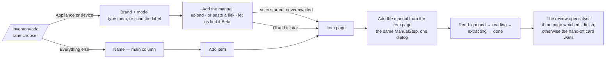
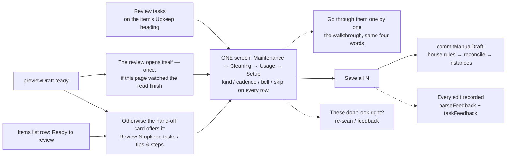
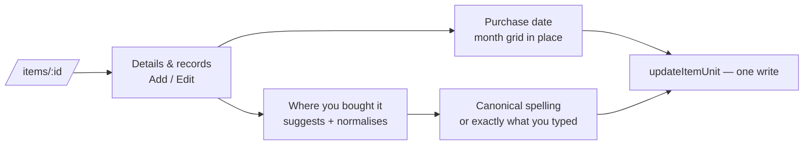

# Homehub user journeys — the happy paths that must not break

This document is the product's spine: the journeys a homeowner actually walks,
traced screen by screen against the code. Every step names the route, the
service behind it, and the spec that guards it — so when a spec goes red, this
doc says which *user promise* just broke; and when a journey changes, the doc
and its specs change **in the same PR**.

**Regeneration rule:** maintained by tracing the code, never from memory. If a
step table disagrees with the app, the app wins — update the doc (and the spec
column) in the PR that changed the flow.

**How the journeys are tested**
- `e2e/journey/journey.spec.ts` — the chained walks below, one worker, with a
  screenshot + note at every step (`npm run test:e2e:journey:emu`). The
  `/journey-smoke` skill has Claude *look at* the resulting gallery — layout
  collapses, empty states posing as success, and wrong copy are caught by eyes,
  not pixel diffs.
- `e2e/emu/*` — per-module specs against the same seeded emulator.
- Seeded identity: `e2e@homehub.test` **in the emulator only** — no real test
  accounts exist anywhere. AI callables are stubbed at the network layer; a
  live parse never runs in e2e (that lives in `evals/manual-parser/`).

---

## Journey 1 — Onboarding: brand-new person to first item

**Promise:** from "never heard of Homehub" to something true and useful about
*her* home in under a minute — a zip, not a street address, and nothing saved
she did not choose ("suggest, never assume") — then a home with its first item,
without a dead end. The first minute is D8 (`design/first-minute-onboarding.md`,
owner-approved mock 2026-11-18). Since 2026-11-20 the account comes AFTER
the list (`design/account-after-list.md`): zip, area and list run with no
account and write nothing until **Keep your list** signs them in.

```mermaid
flowchart LR
    A[Marketing page /] -->|Get started| C["Where's home?" zip · Skip\n/onboarding/first, no account]
    C -->|zip| D["What your area means for upkeep"\n/onboarding/first · facts + home type]
    C -->|unknown zip| C2[Pick a climate] --> D
    C -->|Skip| L
    D --> L["Worth doing this month"\n≤3 rows · Add / Not now]
    L -->|signed out| K["Keep your list" sheet\nApple · email + password]
    K --> G
    L -->|signed in| G[Home: This week + Coming up\n+ "What's in your home?"]
    L -->|Not now| W["Empty Home: What's in your home?"\nSafety · Heating and water · Appliances]
    W -->|tick → See Suggested Care| WC["Suggested for your home"\none Add per row]
    WC -->|Done| G
    W -->|Not now| WN["Home's top: greeting · Ask\nTell us what's in your home (row) · In a pinch"] -->|tap the row| W
    G -->|tap an appliance → Add| G
    G -->|Add My Exact Models| E[First item /inventory/add\n?lane=appliance, Back to the chooser]
    W -->|Add My Exact Models| E
    E --> F[Item page /items/:id]
    F --> G2[Home: the week + first-run tour]
    S[Sign in /signin] -. "?returnTo=/invite/…" .-> H[Accept invite /invite/:token]
```

| # | User sees / does | Route | Key code | Writes |
|---|---|---|---|---|
| 1 | Marketing page → **Get started** (one button, no email box) / Sign in | `/` | `src/pages/Landing.tsx` | — |
| 2 | (removed 2026-11-20: the account is asked for at step 5b) | | | |
| 3 | **Where's home?** — why the zip matters in one line; five digits, "Just the zip. Never your street.", looked up on the device (`src/data/zip-area.json`, its own chunk); **Skip for now**. No invite code. An unknown zip offers the four climate choices | `/onboarding/first` (public) | `FirstMinute.tsx` (`ZipStep`), `zipAreaService` | the on-device draft only (`firstMinuteDraft.ts`) |
| 4 | **What your area means for upkeep** — only the facts that change this month's list, each with its source and **Not true here** / Undo; then the home type | `/onboarding/first` | `FirstMinute.tsx` (`AreaStep`) | the draft only |
| 5 | **Worth doing this month** — ≤3 rows (name, priority, how often; no explanation line), ≤2 inline Yes / No / Not sure, "N picked, not added yet" above Add, × with an optional reason, **Not on your list** with Change. Nothing is saved until **Add** or **Not now**. Skip path: same list, no area words, an **Add zip** row | `/onboarding/first` | `FirstMinute.tsx` (`ListStep`), `shared/care/firstList.ts` | the draft only |
| 5a | Signed out: **Keep your list** sheet over the list — Continue with Apple, Continue with email (email + password, no name; "Already have an account? Sign in"). Not now asks too ("Keep your area and home type"). Once the account exists the save runs by itself (also after Apple's redirect reload); a failure keeps the sheet open with **Try again**; an account that already has a home is asked **Add these N tasks to "…"?** / Don't add — never a second home. Signed in: Add saves straight away | `/onboarding/first` | `KeepListSheet.tsx`, `firstMinuteCommit.ts` → `createHome`, `upsertHomeProfile`, `addLibraryTask(…, { firstDue })` | `homes/{id}` (+ zip, area, climate, `homeType`, `careFacts`, `dismissedCare`, `profileCompletedAt`), `members/{uid}`, 9 default rooms, `taskTemplates` (`library:`) + first `taskInstances` due this weekend |
| 5b | Home: the added tasks under **This week**, a **Coming up in …** line, and one next-step card (design/day-one-home.md): **What's in your home?** appliance chips — a tap shows that appliance's typical care and writes nothing; **Add** makes the item and the checked tasks; **Add My Exact Models** (outlined, "Brand and model, or the manual, gets you the maker's schedule.") opens the add screen's appliance lane, with the selected kind pre-picked under "What is it?", or the item just added (before-friends B4, replacing **Snap a label instead**). With an item, or after **Not now**: one question at a time (Yes → offer → Add). Nothing left and no items: **Get the exact schedule · Snap a label**. From the month after the home was created, **This month at your home** (`MonthlyRefreshCard.tsx`) takes the slot until Add or Not now answers the month | `/home` | `Home.tsx`, `NextStepCard.tsx`, `shared/care/dayOne.ts`, `homeWeek.ts` (`comingUpLine`) | on Add: `items/{id}`, `taskTemplates` (`library:`), `careFacts`, `dismissedCare` |
| 5c | **Empty Home** (no items, no tasks — e.g. **Not now** on the list): **What's in your home?** in the old "Let's set up your home" hero's place (before-friends mock 1). Chips in three groups — Safety (Smoke alarms, **Carbon monoxide (CO) alarms**, Fire extinguisher), Heating and water, Appliances (+ More…); **See Suggested Care** (filled, the only filled button) is off until a chip is ticked and the card's own read says the home is empty; **Add My Exact Models** opens `/inventory/add?lane=appliance` (`&kind=` for exactly one appliance with a chip); **Not now** shrinks it to one row, **Tell us what's in your home**, remembered on this phone, that brings it back — and Home shows its own top around that row (seventeen fixes mock m3, owner 2026-11-25): the greeting and date, Ask with its starter chips, the row where Next up goes, then In a pinch; no Next up, Coming up, "All quiet" or profile banner, and the tour still waits (the row carries `data-tour-halt`). See Suggested Care saves only the ticked facts as true, then **Suggested for your home** lists one row per task (Essential in clay, cadence, minutes; the carbon monoxide (CO) row says why), each with its own **Add**; nothing is created before that tap. An appliance becomes an item with its first task (D1). **Done** hands Home back (the tour waits for the next visit, D10); Done with nothing added leaves the one-line row (D9). No "This month at your home" here | `/home` | `Home.tsx` (`showSetup`, the pin), `WhatsInYourHomeCard.tsx`, `dayOneData.ts`, `shared/care/dayOne.ts` (`HOME_PICK_GROUPS`, `careForPicks`, `exactModelsTarget`) | on See Suggested Care: `careFacts` (ticked facts only); on Add: `taskTemplates` (`library:`), `items/{id}` for an appliance's first task |
| 5d | **Add your zip** (seventeen fixes mock m5, owner 2026-11-25; replaces "Finish your home profile", which no longer renders): when the home has no zip, one row under Next up — "Add your zip / Get the tasks that matter for your weather and area.", a 44px ✕ ("Not now", saved per person per home on the server: `zip_row_dismissed` in the prefs doc) and a chevron. It opens the first minute's screens for THIS home: Where's home? (Not now → Home, nothing written) → What your area means with Not true here (the home-type question only if the home has none; the step skipped when there is nothing to show) → Worth doing this month with ONLY what the zip brings that the home doesn't have (its tasks, `dismissedCare`, and everything it would be offered without a zip are left out; "Your zip doesn't add anything new this month." when that is nothing) → Home, the row gone. No account sheet, no new home; a failed read or write is said with Try again | `/home`, `/home/zip` | `ZipRow.tsx`, `FirstMinute.tsx` (`ZipForHome`), `firstMinuteCommit.ts` (`readHomeForZip`, `saveZipToHome`) | `homes/{id}` (+ zip, area, climate, `freezeRisk`, `careFacts`, `dismissedCare`; `homeType` and `profileCompletedAt` only if unset), picked `taskTemplates` (`library:`); `users/{uid}/private/preferences.zip_row_dismissed` on ✕ |
| 6 | Lane chooser → simple lane: **Name on the main column** → Add item | `/inventory/add` | `IdentifyStep.tsx`, `SmartAddItem.tsx` → `createItemUnit` | `homes/{id}/items/{id}` |
| 6b | Appliance lane instead: brand + model → **Add the manual** (the button and the next screen share the words) → attaching it starts the scan and lands on the item page (J2) | `/inventory/add` | `SmartAddItem.tsx` → `startParseAndLeave` | `homes/{id}/manuals/{id}`, `parse.stage` |
| 7 | Item page: the name first; Upkeep says **"No upkeep yet"**, lists up to two of the kind's typical tasks (each **Add** outlined, **Don't Add** as text) when the care library knows the kind, and has one **Add the Manual** door (before-friends mock 2, superseding HH-91's "No upkeep yet — add the manual"). One tree for the width, so one of each (HH-159). While a manual is being read: **"Reading the manual"** inside the Upkeep card — one line, the worker's page count, an indeterminate rail, and "You can close the app — these keep going." (HH-135, HH-116) — and the Items tab counts it (its description reads "1 reading"); nothing floats over the page (owner, 2026-11-20, superseding HH-161's pill) | `/items/:id` | `ItemDetailPage.tsx` (`useIsDesktop`), `CareBlock.tsx`, `ParsePickupCard.tsx`, `ScanTray.tsx` | — |
| 7b | Scan done → **the review, one screen**: Maintenance → Cleaning → Usage → Setup, each row carrying its own cadence and bell. A section of the page for anyone who watched the scan run, a drawer for anyone who came back; it opens itself only when there is maintenance to decide (HH-121). With none, round 14's card reports instead ("We finished reading the … manual") — superseded in `docs/add-item-flow.md`, to be retired by the HH-161 work (Package E2) | `/items/:id` | `ParsePickupCard.tsx`, `TaskReviewSheet.tsx` | `commitManualDraft` → `taskTemplates`, `taskInstances` |
| 8 | Home: the first-run tour (5 steps, the first titled **"Welcome"**, Esc-closable; held while the label card shows), then the week with the first minute's tasks. A home that added nothing still gets **"No upkeep yet — add a manual"** (HH-80) | `/home` | `useFeatureTour`, `tourSteps.ts`, `Home.tsx` | — |

**Guards that make or break this journey**
- `AuthGate` / `HomeGate`; the **`fromCache` guard** in `homeService.getMyHomes` —
  an empty membership read served from cache is an *error*, never "no home"
  (the duplicate-home-incident fix). `firstMinuteCommit` re-checks before creating,
  and a home it made on a half-failed save is reused (`createdHomeId`), never doubled.
- **Invite gate, retired from the client 2026-11-20.** The rules still require
  `admitted()`, which passes because `config/growth.inviteGateEnabled` is `false`
  in production and in the seed. It fails CLOSED when that doc is absent — a
  missing doc would refuse every new home ("Couldn't create your home"). Removing
  the rules gate and `redeemInviteCode` needs a rules + functions deploy.
- **After sign-in** `refresh(homeId)` polls until the members collection-group
  query can see the just-created home, then Home. Index sends a signed-in person
  with no home to `/onboarding/first`.

**The 2026-08-22 flow change (PRs #160–#163):** the profile no longer funnels
straight into the add form — it offers the two doors above. The wizard ends at
the manual; Reading, Review and Purchase left it. The item page watches the
manual being read and asks for ONE review. Round 18 (#185) made that review one
screen grouped by kind; `docs/add-item-flow.md` is the canonical flow.

**Spec coverage:** `journey.spec.ts` J1 (Get started → zip 94110 → area facts with
Not true here / Undo → condo → this month's three rows → Add → Keep your list →
email sign-up → Home's week and
Add My Exact Models → appliance lane → Back → simple-lane item → the tour → the week;
and its empty-Home walk: Not now on the list → Keep your area and home type → the
card → Not now → Home's top around the collapsed row (greeting, Ask and starters, In a pinch; no Next up, Coming up or All quiet; no tour) → the row survives a reload → pick four → Suggested for
your home → two Adds → Done → the normal Home with no tour yet; the clock is pinned to
the mock's day; steps 7b and the scan are J2's and `emu/item-page-manual`'s) ·
`WhatsInYourHomeCard.test.tsx` (mock 1's must-be-true list, the take-back, the
pin) · `a11y` ("What's in your home?" in its three states, both themes, 390px and desktop) ·
`FirstMinute.test.tsx` (D8 must-be-true 1–15, the sheet, the redirect resume,
the failure paths, the existing-home question, the skip path) ·
`firstMinuteCommit.test.ts` · `firstMinuteDraft.test.ts` · `emu/auth-home` · `emu/smart-add` (the spec that
caught the accordion dead-end) · rules tests, `inviteActions.emu`, `membership.emu`.

---

## Journey 2 — Add item & attach its manual

**Promise:** "a name is enough to start"; brand+model finds the manual, and
the manual is where upkeep comes from.



Key mechanics (the agreement is `docs/add-item-flow.md`; fuller data trace in
`docs/firestore-model.md` §8):
- **Two screens, and the wizard ends at the manual.** Identify, then Add the
  manual (appliance lane only). The Stepper is retired (`retiredDesigns.test.ts`).
  An appliance add writes a wizard session (`setWizardSession`, step `manual`),
  so leaving on the manual screen resumes there; retired steps normalise
  forward (`wizardSession.ts`).
- **Appliance lane (HH-110, HH-123):** two fields, brand and model. Scanning the
  label is a first-class choice under an "or" rule (`ocr` callable — Vision +
  Claude fallback), and a scan overwrites both as a pair (HH-139). Tips appear
  only after a read comes back empty. **No lookup runs here** (round 18):
  `runPostCreateLookup` fires once after the item exists, and whatever it finds
  waits on the item page as suggestions.
- **The manual step is RANKED (HH-109, HH-115):** choosing a file leads and
  carries the only filled control; paste-a-link says *must end in .pdf* and
  hands over a Google search for the model (HH-129); **search is last**, badged
  Beta, and says it often returns the wrong document. The drop zone exists on
  desktop only. Zero-byte files are refused before any upload (HH-128); at
  capacity the button stands down and says the scan is queued (HH-124, HH-131).
- **The item page's door is the same component.** Upkeep's *Add the manual*,
  the drop-zone, *Paste a link instead* and *Find it for me* all open one
  dialog rendering `ManualStep` (HH-126), and work on the first tap (HH-159).
- **Naming (HH-112):** `composeItemName` names the item for what it is — the
  category label, with the room appended only when that name is taken. Known
  gap: an appliance-lane add still starts as "Brand Model" (Package E3).
- **Vocabulary:** the app READS a manual — "Reading the manual", "1 reading",
  "Read again". Never "parse" (jargon). HH-161 retired the old "never read"
  rule; the add dialog's "Scan the manual", the internal manuals list (Settings → Internal tools) and a few
  other lines still say "scan" for the read until they are converted
  (`docs/add-item-flow.md` lists them). A camera still scans a label.
- **Doc-type honesty:** `detectDocType` gates spec sheets/warranties (*Use
  anyway / Replace*); `modelMismatch` warns on wrong variants — warn, never block.
- **Parse pipeline:** `enqueueParse` (membership + quota: 10 units, in-flight
  cap 5/home; a manual already being read is refused before any charge and the
  client follows that scan; writes `parse.stage = "queued"` before it returns)
  → Cloud Task → `parseWorker` → stages on `manuals/{id}.parse.stage` →
  `previewDraft`. Preview **never commits** without review. The wizard starts
  the scan and leaves; the item page **watches it and never starts one** (audit
  2026-09-29).
- **Spend caps:** per-user daily and app-wide monthly unit ceilings live in the
  server-only `config/spend` doc (defaults and rules in `shared/quota/policy.ts`,
  enforced in `firebase/functions/src/lib/quota.ts`; `monthlyCeilingUnits: 0` is
  the kill switch, `docs/rollback.md`), plus per-minute rate and burst caps; a
  throttled call costs nothing; quota refusals surface as calm notices, never
  errors.

**Spec coverage:** `journey.spec.ts` J2 (appliance lane → the ranked manual
step → the item page, enqueue stubbed) · `emu/smart-add` (simple-lane create,
OCR states, exactly one enqueue per add) · `emu/item-add-manual` (the item
page's upload doors at 390px and desktop) · `emu/item-page-manual` (the link
lane from a seeded appliance, the read's live state) ·
`emu/item-page-scan-indicator` (HH-161's frames: the read in Upkeep, the Items tab
count and the item's row in the Items list, the hand-off, the review) · `emu/scan-fit`
· `emu/storage` · `emu/knowledge*` · `worker.emu`, `quota.emu` (server) ·
parser quality: `evals/manual-parser/`.

---

## Journey 3 — Review parsed tasks

**Promise:** nothing enters the schedule without the homeowner agreeing —
and every correction teaches the parser.



Key mechanics:
- **One screen, grouped by what a task IS** (round 18, #185): Maintenance →
  Cleaning → Usage → Setup, Setup collapsed (HH-85). Importance is a rail on
  the row, not a heading. No maintenance simply means no Maintenance section
  (HH-142). There is no step 2 and no "Next" — each row carries its cadence
  chip and its bell, and the walkthrough survives for going one by one (HH-144).
- **The summary states two channels, apart:** how many show up in Tasks when
  due — counted by the Tasks page's own rule, so item cleaning (its section:
  "Lives on the item page") is not in it, and with nothing there it reads
  "Nothing here goes into Tasks." — and how many also notify the phone: the
  bells on screen. Essential is the only notify-by-default. No bell on item
  cleaning, and none anywhere on a phone that refused notifications: the
  collapsed row says "Reminders off", and the opened row offers "Turn on in
  Settings" beside its switch (HH-161, as the owner's review of #228 refined
  it).
- **Two doors, one screen (HH-119):** `ParsePickupCard` (after a read — the
  add, "Read the manual", "Read again"; a ready row in the Items list and the internal manuals list's Review open it
  too) and **Review tasks** on the item's Upkeep heading
  (`ReviewItemTasksButton`, the phone layout). The manual section's own review
  is gone (HH-161). The `focus` prop defaults to the approved review, so a door
  that passes nothing gets it; `src/lib/designContracts.test.ts` fails if a
  third door appears.
- It never claims rows are saved while its button is what saves them (HH-134):
  tasks already on the item say **Done**; a fresh parse says **Save all N**.
- Thin-manual warning first (`shared/parse/pdfShape.ts`).
- Save → `commitManualDraft` re-normalizes server-side, re-applies **house
  rules** (`applyHouseRules` — a freeze-free home suppresses the freeze_prep
  family), reconciles templates by `externalKey` (**never deleting
  completion-bearing tasks**), mints first instances one cadence from the
  anchor (`last_done_on ?? today`).
- **Replace or Keep Both** (before-friends PR D): on a fresh read's review, a
  maintenance row that is the same job as a typical (care library) task
  already on the item asks, inside the row, Replace or Keep Both (same-job
  match → Replace; wording-only → Keep Both). Save sends `typicalChoices`;
  `commitManualDraft` checks each against the item's templates and applies it
  in the same commit. The stored-task review (Review tasks) never asks.
- Every correction becomes `review_save` feedback; generalizable ones carry a
  cross-home `patternKey` for the weekly `graduateFeedback` aggregation.
  Feedback **never edits the prompt** — candidates route through the goldens.

**Spec coverage:** `journey.spec.ts` J3 (phone-width walk of the one-screen
review from **Review tasks** on the seeded dishwasher — its tasks are already
saved, so it ends on Done and writes nothing; its only task is item cleaning,
so "Nothing here goes into Tasks.") · `emu/task-review` (the review WRITE: a
row refiled as Maintenance, a cadence and a bell changed, saved, read back) ·
`emu/notice-fit` (the hand-off card's layout) · `emu/item-page-scan-indicator`
(the count, the bells, notifications refused) ·
`TaskReviewSheet.*.test.tsx`, `src/lib/designContracts.test.ts` ·
`commitManualDraft.emu`, `lastDoneAnchor.emu`, `typicalChoices.emu` (server) ·
`emu/item-replace-typical` (Replace or Keep Both drawn at 390px light and dark
and desktop, and what Save sends). J3's walk asserts the stored-task review
renders no Replace question.

---

## Journey 4 — Live with your tasks (agenda, detail, snooze)

**Promise:** relevant, useful, timely — windows not deadlines, calm by
default, "this isn't right" always one tap away.

```mermaid
flowchart LR
    A[Home /home\n"This week", first task open] --> B[Tasks /maintenance\nUpkeep: lenses + calendar]
    B --> H[Tasks ?view=cleaning\nStart cleaning + guides]
    B --> C[Row opens as the task card:\nMark done / Snooze · arrow to the task page]
    C --> D[Task detail /tasks/:id\nwindow phrase, steps]
    D --> E[Mark done → completeTask\nnext instance minted]
    A --> F[Snooze +14 from the open row\nvisible Undo]
    D --> G["This isn't right"\nchips + sweep + Discuss]
```

Key mechanics:
- One `taskInstances` read feeds everything (denormalized fields;
  `getWeekAgenda`, `useDashboard`). Due windows derived at read time
  (`shared/care/dueWindow.ts`) — **only a passed deadline is ever "overdue"**;
  lapsed safety earns **"Worth doing — N safety checks have skipped a cycle"**
  (`computeInsight`); seasonal windows resolve against home climate; an empty
  agenda explains what's withheld.
- Home (design/home-next.md, owner 2026-11-21): **Ask** as one field; **Next up**,
  the week's first task as the task card, with "N more this week" to Tasks;
  **Heads up** (a recall, a manual ready to review, a warranty ending inside 60
  days; hidden when empty); **Coming up** (up to three tasks after this week, a
  month tile, the day only for a real deadline; a new home sees each task's next
  round); the one next-step card; **In a pinch** (water, gas and power shutoffs
  from house notes, then Your pros; an empty row says Add and opens that note;
  a failed read says so, never Add); **Pinned by you** (notes pinned from House
  notes; hidden when none). The week list, the warranty line and the desktop
  recall rail are gone from Home.
- Tasks: rows (phone and desktop) open in place into the task card (Mark
  done / Snooze; the arrow → `/tasks/:id`). Inside every group
  (any lens, both widths) a passed deadline leads, then rows run Essential →
  Recommended → Optional, the date breaking ties; no row repeats its group's
  name — neither the when-phrase ("Good to do now") nor the item/room
  ("Furnace" under the Furnace group) (HH-165).
- Tasks has two views under one segmented control, **Upkeep | Cleaning**
  (`design/tasks-items-views.md`), held in the URL as `?view=` (absent =
  Upkeep). Upkeep is the agenda above. Cleaning is what was the Clean page —
  the "Start cleaning" session and the cleaning guides, with "N cleaning
  guides" under the title and none of Upkeep's lenses, priority filter or
  calendar; Clean's own "This week" list is gone (the week is one list, in
  Upkeep). `/clean` redirects (replace) to `/maintenance?view=cleaning`;
  `/clean/:itemUnitId` (an appliance's guide) stays, its "Back to Cleaning"
  link going to the view. Items has the same control, **Items | Warranties**
  (`/inventory?view=warranties`; `/warranties` redirects), shown only when the
  home has items. Neither Clean nor Warranties is in the desktop nav.
- **Complete** → `completeTask` callable: one transaction marks done, computes
  the next due, suppresses duplicates, mints the next instance. (Browser-level
  Mark done needs the functions emulator — covered server-side by
  `completeTask.emu`; the journey walk exercises **Snooze + Undo** instead,
  which are pure Firestore writes.)
- Feedback: chips (+ sub-pickers), similar-task sweep, Discuss (grounded in
  manual chunks, may propose ONE chip-shaped edit), deterministic safety
  pushback on hazard downgrades; resolutions write append-only `taskFeedback`
  and (when generalizable) visible `houseRules` that `commitDraft` replays.
- Push: deadlines the day they land; everything else in the Sunday digest —
  selection uses the same agenda filter, so a push can't contradict the screen.

**Spec coverage:** `journey.spec.ts` J4 (Home's open row → agenda → expanded
row → detail → snooze + undo) · `emu/tasks`, `emu/home`, `emu/home-week`,
`emu/item-detail`, `emu/clean` (Upkeep | Cleaning, `/clean` redirect),
`emu/warranties` (Items | Warranties, `/warranties` redirect) ·
`completeTask.emu`, `rollForward.emu`, `discussTask.emu` (server).

---

## Journey 5 — Records: purchase date and where you bought it

**Promise:** the two fields a warranty or insurance claim asks for are quick to
enter and consistent once entered.



Key mechanics:
- **Date:** `DateField` opens a month grid in place rather than the iOS wheel —
  a purchase date is nearly always a month or two back, which is three columns
  of scrolling on the native control. Always six rows so the buttons don't move
  under your thumb. Future dates are refused.
- **Timezone:** `lib/monthGrid.ts` is pure number/string work.
  `new Date("2024-03-14")` is UTC midnight, i.e. the 13th anywhere west of
  Greenwich — the bug that silently moves a purchase date back a day on every
  reload. Pinned by tests that pass in three timezones.
- **Store:** `StoreField` merges this home's own `store_name` values (ranked by
  use) with a curated seed in `lib/storeSuggestions.ts`, so the first item gets
  help and the second normalises. The raw text is **always** the last option —
  suggesting is not deciding.
- **One read, two autocompletes:** the item page already fetched every home item
  for tag suggestions; store history comes from that same snapshot.

**Spec coverage:** `journey.spec.ts` J5 · `lib/monthGrid.test.ts` (13) ·
`lib/storeSuggestions.test.ts` (16) · `lib/itemName.test.ts` (12).

---

## Coverage map

| Journey | Chained walk | Module specs | Server-side |
|---|---|---|---|
| J1 Onboarding | `journey.spec.ts` J1 | `emu/auth-home`, `emu/smart-add` | rules tests, `inviteActions.emu`, `membership.emu` |
| J2 Add + manual | `journey.spec.ts` J2 | `emu/smart-add`, `emu/item-add-manual`, `emu/item-page-manual`, `emu/scan-fit`, `emu/storage`, `emu/knowledge*` | `worker.emu`, `quota.emu`, parser goldens |
| J3 Review | `journey.spec.ts` J3 | `emu/task-review`, `emu/notice-fit`, `emu/item-replace-typical` | `commitManualDraft.emu`, `lastDoneAnchor.emu`, `typicalChoices.emu` |
| J4 Agenda | `journey.spec.ts` J4 | `emu/tasks`, `emu/home`, `emu/item-detail`, `emu/clean`, `emu/warranties`, `emu/tasks-desktop-parity` | `completeTask.emu`, `rollForward.emu`, `discussTask.emu` |
| J5 Records | `journey.spec.ts` J5 | `monthGrid`, `storeSuggestions`, `itemName` unit specs | — (client-only write via `updateItemUnit`) |

Across J1–J3, `src/lib/designContracts.test.ts` pins the add-item flow's rules
(`docs/add-item-flow.md`) as behaviour in the unit run — the rules still unmet
are its `it.todo`s, each naming the package that turns it on.

**Known gaps (deliberate, revisit when they hurt):**
- Browser-level **Mark done** needs the functions emulator in the e2e stack;
  it is covered server-side today. The **scan's progress** is walked only up to
  `queued`: `emu/item-page-manual` fakes the stage `enqueueParse` writes, and
  the worker's later stages are covered by `worker.emu`.
- The walk from an item-page attach **into the review** needs a draft the
  worker never writes in e2e; `emu/task-review` covers the review from Review
  tasks instead.
- **Invite acceptance** has no browser journey (server-tested).
- Live AI parse quality is never e2e — `evals/manual-parser/` owns it.
- The a11y suite has an order-dependent mobile flake (a late mobile page
  times out waiting for seeded data when run 10+ tests deep); passes in
  isolation. Predates the journey work.
